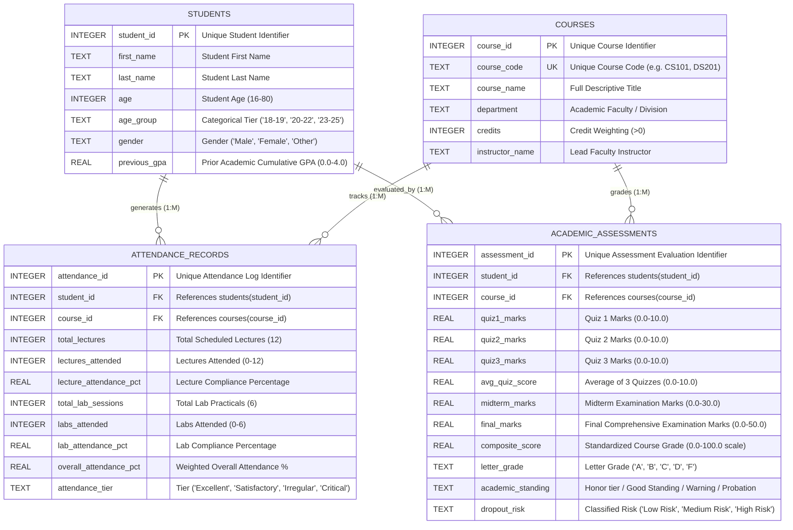

# Deliverable 4: Entity Relationship Diagram (ERD) & Schema Specification

**Project:** End-to-End ETL & Academic Performance Pipeline  
**Database Technology:** SQLite / ANSI SQL Compliant  
**Database File:** `database/student_performance.db`  

---

## 1. Visual Entity Relationship Diagram (Mermaid)

---

## 2. Relational Integrity & Constraint Catalog

| Table | Constraint Type | Constraint Expression / Foreign Target | Purpose |
| :--- | :--- | :--- | :--- |
| `students` | Primary Key | `student_id` | Ensures unique identification of every registered student. |
| `students` | Check | `age >= 16 AND age <= 80` | Enforces realistic collegiate demographic boundaries. |
| `students` | Check | `gender IN ('Male', 'Female', 'Other')` | Enforces categorical consistency. |
| `students` | Check | `previous_gpa >= 0.0 AND previous_gpa <= 4.0` | Restricts GPA to standard collegiate 4.0 scale. |
| `courses` | Primary Key | `course_id` | Guarantees unique primary identification for department courses. |
| `courses` | Unique Key | `course_code` | Eliminates duplicated course codes within the catalog. |
| `attendance_records` | Primary Key | `attendance_id` | Auto-incrementing unique key per attendance entry. |
| `attendance_records` | Foreign Key | `student_id REFERENCES students(student_id) ON DELETE CASCADE` | Prevents orphan attendance rows if a student is removed. |
| `attendance_records` | Foreign Key | `course_id REFERENCES courses(course_id) ON DELETE CASCADE` | Enforces course catalog referential integrity. |
| `academic_assessments` | Primary Key | `assessment_id` | Auto-incrementing unique key per assessment record. |
| `academic_assessments` | Foreign Key | `student_id REFERENCES students(student_id) ON DELETE CASCADE` | Links grades strictly to verified student profiles. |
| `academic_assessments` | Foreign Key | `course_id REFERENCES courses(course_id) ON DELETE CASCADE` | Links grades strictly to verified course offerings. |
| `academic_assessments` | Check | `quiz1_marks BETWEEN 0.0 AND 10.0` | Prevents invalid grading input outside rubric bounds. |
| `academic_assessments` | Check | `composite_score BETWEEN 0.0 AND 100.0` | Bounds normalized score to 100-point collegiate scale. |
