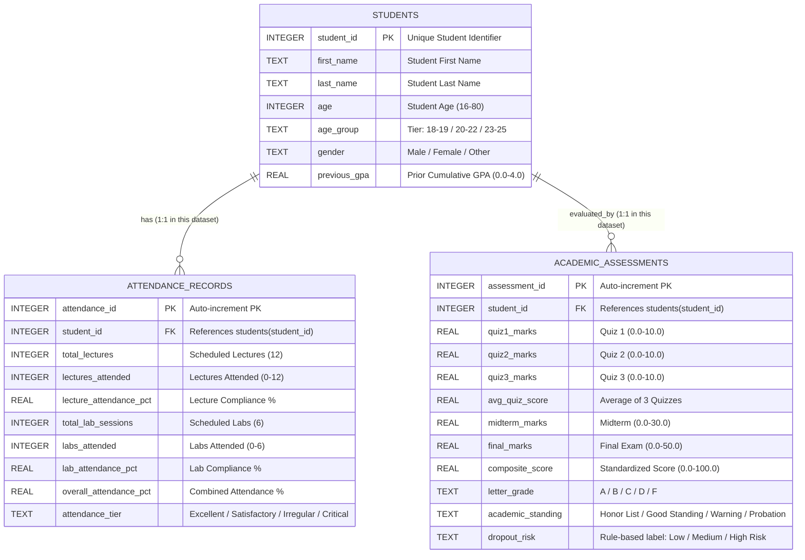

# Entity Relationship Diagram: 3-Table Schema

**Project:** End-to-End ETL & Academic Performance Pipeline  
**Database:** `database/student_performance.db` (SQLite)  
**Tables:** `students`, `attendance_records`, `academic_assessments`  

> **Note:** The raw Kaggle dataset contains no course, department, or instructor data.
> The `courses` table was removed to preserve analytical honesty.

---

## 1. Visual ERD (Mermaid)

---

## 2. Relational Integrity & Constraint Catalog

| Table | Constraint | Expression | Purpose |
|-------|-----------|------------|---------|
| `students` | Primary Key | `student_id` | Unique student identification |
| `students` | CHECK | `age BETWEEN 16 AND 80` | Realistic age bounds |
| `students` | CHECK | `gender IN ('Male','Female','Other')` | Categorical consistency |
| `students` | CHECK | `previous_gpa BETWEEN 0.0 AND 4.0` | Standard GPA scale |
| `attendance_records` | Primary Key | `attendance_id` (AUTOINCREMENT) | Unique attendance log |
| `attendance_records` | Foreign Key | `student_id → students(student_id) ON DELETE CASCADE` | Referential integrity |
| `attendance_records` | CHECK | `lectures_attended <= total_lectures` | Cannot exceed scheduled count |
| `attendance_records` | CHECK | `attendance_tier IN (...)` | Controlled vocabulary |
| `academic_assessments` | Primary Key | `assessment_id` (AUTOINCREMENT) | Unique assessment record |
| `academic_assessments` | Foreign Key | `student_id → students(student_id) ON DELETE CASCADE` | Referential integrity |
| `academic_assessments` | CHECK | `quiz*_marks BETWEEN 0.0 AND 10.0` | Valid quiz score range |
| `academic_assessments` | CHECK | `midterm_marks BETWEEN 0.0 AND 30.0` | Valid midterm range |
| `academic_assessments` | CHECK | `final_marks BETWEEN 0.0 AND 50.0` | Valid final range |
| `academic_assessments` | CHECK | `composite_score BETWEEN 0.0 AND 100.0` | Normalized score |
| `academic_assessments` | CHECK | `dropout_risk IN ('Low Risk','Medium Risk','High Risk')` | Controlled label set |

---

## 3. Dropout Risk Label Definition

`dropout_risk` is assigned in `src/transform.py` by this rule:

| Label | Condition (ANY of) |
|-------|-------------------|
| `High Risk` | `overall_attendance_pct < 40` OR `composite_score < 45` OR `previous_gpa < 1.8` |
| `Medium Risk` | `overall_attendance_pct < 65` OR `composite_score < 60` (and not High Risk) |
| `Low Risk` | All other students |

This is **not** observed dropout data. It is a pedagogical classification label.
